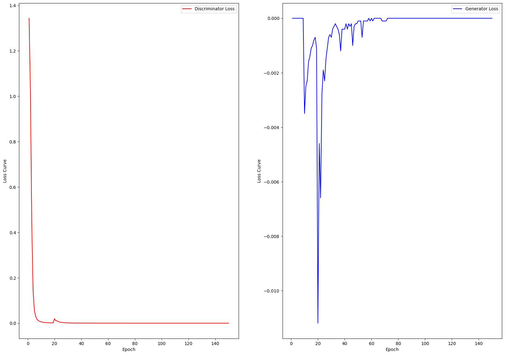
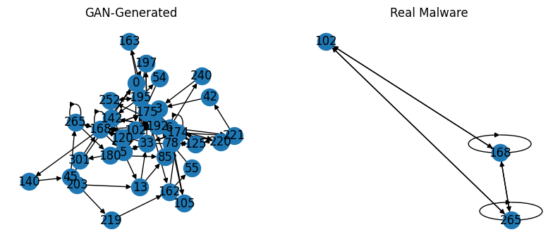

# GAN Intrusion Detection: attacchi sintetici per un IDS basato su system call

Progetto del corso Sicurezza delle Architetture Orientate ai Servizi · Università degli Studi di Milano · ottobre 2025 
Autori: Gaetano Angelo Alberto Loizzo, Michele Vulpio

**Notebook:** [`GAN_Intrusion_Detection.ipynb`](GAN_Intrusion_Detection.ipynb) &nbsp; 

[English version below](#english)

## L'idea

Un intrusion detection system impara da esempi di attività normale e di attacchi, ma gli attacchi sono sempre molti meno. Nel dataset [ADFA-LD](https://research.unsw.edu.au/projects/adfa-ids-datasets), che raccoglie tracce di chiamate di sistema (system call) registrate su un server Linux, ci sono 5205 tracce benigne e 746 attacchi.

Il progetto prova a bilanciare le classi con attacchi sintetici generati da una GAN condizionale e verifica se un classificatore GCN (Graph Convolutional Network) addestrato anche su questi dati riconosce meglio gli attacchi reali. Ogni traccia diventa un grafo: i nodi sono le system call che compaiono nella traccia, gli archi le transizioni tra chiamate consecutive, pesati con il numero di volte in cui si ripetono.

**In breve:** gli attacchi sintetici peggiorano il classificatore. Più sotto spieghiamo perché.

## Come funziona

1. **Dati.** Le 5951 tracce sono divise in training (70%) e test (30%) con uno split stratificato, lo stesso per tutti i confronti. Nel training ci sono 3643 tracce benigne e 522 attacchi, nel test 1562 e 224.
2. **Classificatore di riferimento.** La GCN viene addestrata solo sui dati reali.
3. **Attacchi sintetici.** La GAN condizionale viene addestrata per 150 epoche sulle tracce di training, troncate alle prime 100 system call, e poi usata per generare solo attacchi: 3121, quanti servono per pareggiare le classi nel training set.
4. **Data augmentation.** Gli attacchi sintetici vengono aggiunti solo al training set: il test set resta fatto di tracce reali.
5. **Confronto.** La GCN viene addestrata con e senza attacchi sintetici, in due configurazioni: A, quella del template (3 layer, 128 unità nascoste, dropout 0,4, 35 epoche), e B, più grande (4 layer, 256 unità nascoste, dropout 0,7, 100 epoche).
6. **Realismo dei campioni.** Un grafo generato viene confrontato con i grafi dei 746 attacchi reali su sei metriche (grado medio, clustering, betweenness, densità, diametro e cammino minimo medio): è considerato simile se tutte stanno entro 2 deviazioni standard dalla media.

## Risultati

Metriche sul test set reale (1786 tracce, di cui 224 attacchi). Precision, recall e F1 sono medie macro sulle due classi; MCC è il coefficiente di correlazione di Matthews.

| GCN | Training | Accuracy | Precision | Recall | F1 | MCC |
| --- | --- | --- | --- | --- | --- | --- |
| A | solo dati reali | 0,9485 | 0,8903 | 0,8692 | 0,8794 | 0,7592 |
| A | + 3121 attacchi sintetici | 0,9155 | 0,8206 | 0,7662 | 0,7897 | 0,5843 |
| B | solo dati reali | 0,9541 | 0,9038 | 0,8820 | 0,8925 | 0,7855 |
| B | + 3121 attacchi sintetici | 0,9462 | 0,8681 | 0,8985 | 0,8824 | 0,7660 |

**Come leggerli.** Gli attacchi sintetici peggiorano il classificatore in entrambe le configurazioni. Dalle metriche si ricavano in modo univoco i conteggi sul test set: con la configurazione A il classificatore rileva 127 attacchi su 224 invece di 171, e i falsi allarmi salgono da 39 a 54. Con la B rileva 11 attacchi in più (187 invece di 176), ma i falsi allarmi passano da 34 a 59, quindi F1 e MCC scendono comunque. Il modello migliore è B addestrato sui soli dati reali.

## Perché i dati sintetici peggiorano il classificatore

Analisi a posteriori, fatta rileggendo il codice e gli output del notebook.

**1. La GAN non impara.** Il nostro notebook parte dalla versione di giugno 2024 del notebook del template, ma su Colab il template viene clonato all'ultima versione, di aprile 2025. In questa versione `train_gan_model` ha un nuovo parametro, `warm_up_epochs`, che vale 10 se non viene indicato: per le prime 9 epoche si addestra solo il discriminatore (il notebook aggiornato del template passa `warm_up_epochs=0`). Quando all'epoca 10 il generatore comincia ad allenarsi, il discriminatore distingue già le tracce reali da quelle generate quasi senza errori (loss 0,008). La loss del generatore, log(1 − D(G(z))), è quindi vicina a zero e dà gradienti minimi: è il problema noto della loss originale delle GAN quando il discriminatore è troppo forte ([Goodfellow et al., 2014](https://arxiv.org/abs/1406.2661)). Il generatore impara poco e fino all'ultima epoca il discriminatore riconosce i campioni finti senza difficoltà: entrambe le loss finiscono a 0,0000.

*Loss del discriminatore (a sinistra) e del generatore (a destra). Quella del generatore è zero per le prime 9 epoche, quando il generatore non viene addestrato, e poi resta vicina a zero.*

**2. Il classificatore impara a riconoscere i campioni sintetici, non gli attacchi.** Nel training set aumentato 3121 attacchi su 3643 (l'86%) sono sintetici, e si distinguono da quelli reali anche per la lunghezza: sono tutti di 100 system call, perché la GAN lavora su tracce troncate, mentre le tracce reali usate dalla GCN sono intere (fino a 4494 chiamate nel training set). In addestramento l'F1 sulla classe attacco sale a 0,97 in entrambe le configurazioni, contro 0,80 e 0,79 senza dati sintetici, ma sul test set reale le prestazioni scendono. Il modello riconosce facilmente gli attacchi sintetici, e questo non lo aiuta con quelli veri.

**3. Il controllo di realismo è troppo debole.** L'ultima sezione del notebook conclude che il grafo generato è "abbastanza simile" agli attacchi reali, perché tutte e sei le metriche stanno entro 2 deviazioni standard dalla media. Però il confronto usa un solo campione generato, e i grafi reali sono così variabili che la soglia accetta anche grafi molto diversi: il clustering medio è 0,15 per il grafo generato e 0,64 in media per quelli reali, la densità 0,14 contro 0,94.

*Il primo grafo generato (a sinistra) e il grafo di un attacco reale (a destra), dalla sezione finale del notebook. Ogni nodo è una system call, indicata con il suo numero.*

## Cosa si potrebbe migliorare

- Addestrare la GAN senza warm-up (`warm_up_epochs=0`) oppure con la loss non saturante −log D(G(z)), già presente come commento nel codice del template.
- Generare tracce di lunghezza variabile, o troncare allo stesso modo anche quelle reali, per non dare al classificatore una scorciatoia.
- Misurare il realismo su tutti i campioni generati e non su uno solo, per esempio con un classificatore addestrato a distinguere tracce reali e sintetiche.
- Ripetere ogni esperimento con più seed: nel notebook ogni configurazione è eseguita una volta sola, quindi una differenza piccola come quella della configurazione B (MCC 0,786 contro 0,766) potrebbe dipendere dalla casualità dell'addestramento.

## Come eseguirlo

1. Scarica ADFA-LD dalla [pagina ufficiale UNSW](https://research.unsw.edu.au/projects/adfa-ids-datasets). Il dataset non è incluso nel repository: è libero per la ricerca accademica (non per uso commerciale) e va citato con l'articolo di G. Creech e J. Hu, "Generation of a new IDS test dataset: Time to retire the KDD collection", IEEE WCNC 2013.
2. Prepara uno zip `ADFA-LD.zip` con dentro la cartella `ADFA-LD`, che contiene `Training_Data_Master`, `Validation_Data_Master` e `Attack_Data_Master`.
3. Apri il notebook su Colab con il pulsante in alto, scegli un runtime con GPU, carica lo zip in `/content` ed esegui tutte le celle. Il notebook clona il template alla stessa versione usata nell'esecuzione originale (commit `0aa64f9`) e ne installa le dipendenze.

## Template e licenza

Il notebook è una versione modificata di `train_evaluate_models.ipynb` del template [gweldit/VanillaGAN](https://github.com/gweldit/VanillaGAN), distribuito con licenza Apache 2.0 ([copia in `third_party/`](third_party/VanillaGAN-LICENSE)). Dal template vengono il preprocessing di ADFA-LD, la conversione in grafi, i modelli, le funzioni di addestramento e valutazione e le celle che dividono i dati, addestrano la GCN di riferimento e la GAN. Il nostro lavoro riguarda il resto: l'ambiente Colab e il caricamento del dataset, la generazione dei soli attacchi in numero sufficiente a bilanciare le classi, la data augmentation, i riaddestramenti della GCN nelle due configurazioni e il confronto strutturale.

Rispetto al notebook originale, la versione pubblicata qui:

- aggiunge un'intestazione e le conclusioni;
- fissa la versione del template clonato (commit `0aa64f9`, quella in uso al momento dell'esecuzione);
- toglie una cella che cercava di estrarre un file inesistente (`ADFA.zip`) e non aveva effetti;
- corregge i nomi delle cartelle nel controllo del dataset, che segnalava per errore due cartelle mancanti (l'output di quella cella è stato rimosso);
- sostituisce due annotazioni sbagliate: il commento del template sul numero di tracce di training (ora 3643 benigne e 522 attacchi) e una nota sul numero di campioni generati (ora 3121, quelli usati davvero);
- toglie dai metadati di Colab le sezioni compresse e la richiesta di un runtime con RAM elevata.

Tutti gli altri output sono quelli dell'esecuzione originale su Colab, con GPU T4.

## Struttura del repository

| Percorso | Contenuto |
| --- | --- |
| `GAN_Intrusion_Detection.ipynb` | Notebook con codice e output dell'esecuzione |
| `figure/` | Le figure di questo README, estratte dagli output del notebook |
| `third_party/` | Licenza Apache 2.0 del template VanillaGAN |

## English

**GAN Intrusion Detection** tests whether synthetic attacks from a conditional GAN can help a graph-based intrusion detection classifier. Built on the [gweldit/VanillaGAN](https://github.com/gweldit/VanillaGAN) template (Apache 2.0), the notebook turns ADFA-LD system-call traces into graphs, trains a conditional GAN on the training split and generates 3,121 synthetic attacks to balance the classes (3,643 benign traces vs 522 attacks), adding them to the training set only. A GCN classifier is then trained with and without the synthetic data, in two configurations.

The synthetic data made the classifier worse in both configurations: on the real test set, MCC dropped from 0.759 to 0.584 and from 0.786 to 0.766. A post-hoc analysis traces this to the GAN training. The template version cloned at run time trains the discriminator alone for the first 9 epochs (`warm_up_epochs=10` by default), so when the generator starts, the discriminator already rejects its samples and the saturating generator loss gives almost no gradient. The synthetic attacks, all exactly 100 calls long unlike the full-length real traces, are easy for the classifier to fit (training F1 0.97) but do not help it on real attacks. Course project for Security of Service-Oriented Architectures, University of Milan (October 2025), by Gaetano Angelo Alberto Loizzo and Michele Vulpio. The ADFA-LD dataset is not included: see the [official UNSW page](https://research.unsw.edu.au/projects/adfa-ids-datasets).

---

© 2025 Gaetano Angelo Alberto Loizzo e Michele Vulpio. Tutti i diritti riservati: il materiale è pubblicato solo come portfolio e non può essere riutilizzato senza autorizzazione. Le parti derivate dal template gweldit/VanillaGAN restano soggette alla [licenza Apache 2.0](third_party/VanillaGAN-LICENSE). *All rights reserved; published for portfolio purposes only. Parts derived from gweldit/VanillaGAN remain under the Apache License 2.0.*
