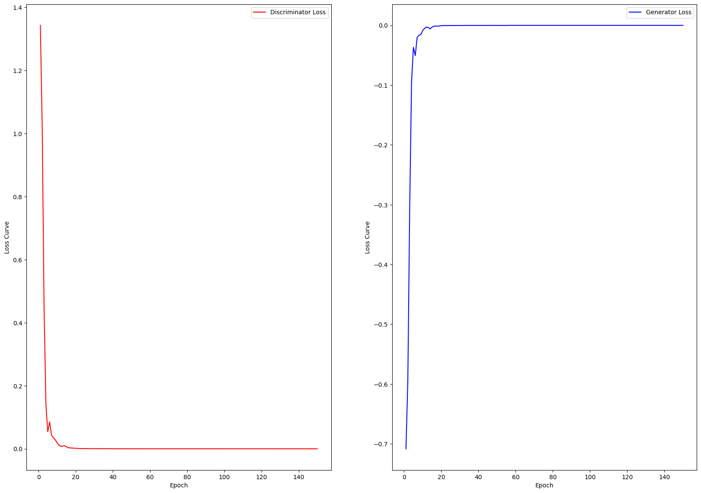

# GAN Intrusion Detection: attacchi sintetici per un IDS basato su system call

Progetto del corso Sicurezza delle Architetture Orientate ai Servizi · Università degli Studi di Milano · ottobre 2025, versione corretta novembre 2026 
Autori: Gaetano Angelo Alberto Loizzo, Michele Vulpio

**Notebook:**
- [`GAN_Intrusion_Detection.ipynb`](GAN_Intrusion_Detection.ipynb): versione originale (ottobre 2025)
- [`GAN_Intrusion_Detection_corretto.ipynb`](GAN_Intrusion_Detection_corretto.ipynb): versione corretta (novembre 2026) &nbsp; 

[English version below](#english)

## L'idea

Un intrusion detection system impara da esempi di attività normale e di attacchi, ma gli attacchi sono sempre molti meno. Nel dataset [ADFA-LD](https://research.unsw.edu.au/projects/adfa-ids-datasets), che raccoglie tracce di chiamate di sistema (system call) registrate su un server Linux, ci sono 5205 tracce benigne e 746 attacchi.

Il progetto prova a bilanciare le classi con attacchi sintetici generati da una GAN condizionale e verifica se un classificatore GCN (Graph Convolutional Network) addestrato anche su questi dati riconosce meglio gli attacchi reali. Ogni traccia diventa un grafo: i nodi sono le system call che compaiono nella traccia, gli archi le transizioni tra chiamate consecutive, pesati con il numero di volte in cui si ripetono.

**In breve:** gli attacchi sintetici non aiutano il classificatore. Nella versione originale lo peggiorano nettamente; in quella corretta, che elimina un problema nell'addestramento della GAN, lo peggiorano di poco o lo lasciano quasi invariato. Il motivo è che la GAN non riesce a generare attacchi realistici, come spieghiamo più sotto.

## Come funziona

1. **Dati.** Le 5951 tracce sono divise in training (70%) e test (30%) con uno split stratificato, lo stesso per tutti i confronti. Nel training ci sono 3643 tracce benigne e 522 attacchi, nel test 1562 e 224.
2. **Classificatore di riferimento.** La GCN viene addestrata solo sui dati reali.
3. **Attacchi sintetici.** La GAN condizionale viene addestrata per 150 epoche sulle tracce di training, troncate alle prime 100 system call, e poi usata per generare solo attacchi: 3121, quanti servono per pareggiare le classi nel training set.
4. **Data augmentation.** Gli attacchi sintetici vengono aggiunti solo al training set: il test set resta fatto di tracce reali.
5. **Confronto.** La GCN viene addestrata con e senza attacchi sintetici, in due configurazioni: A, quella del template (3 layer, 128 unità nascoste, dropout 0,4, 35 epoche), e B, più grande (4 layer, 256 unità nascoste, dropout 0,7, 100 epoche).
6. **Realismo dei campioni.** I grafi generati vengono confrontati con quelli dei 746 attacchi reali su sei metriche (grado medio, clustering, betweenness, densità, diametro e cammino minimo medio): un grafo è considerato simile se tutte stanno entro 2 deviazioni standard dalla media degli attacchi reali.

## Risultati

Metriche sul test set reale (1786 tracce, di cui 224 attacchi). Precision, recall e F1 sono medie macro sulle due classi; MCC è il coefficiente di correlazione di Matthews. Il numero di attacchi rilevati e di falsi allarmi citato sotto le tabelle si ricava in modo univoco da queste metriche.

### Versione originale (ottobre 2025)

| GCN | Training | Accuracy | Precision | Recall | F1 | MCC |
| --- | --- | --- | --- | --- | --- | --- |
| A | solo dati reali | 0,9485 | 0,8903 | 0,8692 | 0,8794 | 0,7592 |
| A | + 3121 attacchi sintetici | 0,9155 | 0,8206 | 0,7662 | 0,7897 | 0,5843 |
| B | solo dati reali | 0,9541 | 0,9038 | 0,8820 | 0,8925 | 0,7855 |
| B | + 3121 attacchi sintetici | 0,9462 | 0,8681 | 0,8985 | 0,8824 | 0,7660 |

Gli attacchi sintetici peggiorano il classificatore in entrambe le configurazioni. Con la A rileva 127 attacchi su 224 invece di 171, e i falsi allarmi salgono da 39 a 54. Con la B rileva 11 attacchi in più (187 invece di 176), ma i falsi allarmi passano da 34 a 59, quindi F1 e MCC scendono comunque.

### Versione corretta (novembre 2026)

Rispetto all'originale cambiano tre cose:

1. la GAN si addestra senza warm-up (`warm_up_epochs=0`), cioè generatore e discriminatore si allenano insieme dalla prima epoca;
2. il classificatore usa solo le prime 100 chiamate di ogni traccia, reale o sintetica, così la lunghezza non distingue più le tracce generate;
3. il controllo di realismo usa tutti i 3121 grafi generati invece di uno solo, e applica lo stesso criterio anche agli attacchi reali come termine di paragone.

| GCN | Training | Accuracy | Precision | Recall | F1 | MCC |
| --- | --- | --- | --- | --- | --- | --- |
| A | solo dati reali | 0,9434 | 0,8822 | 0,8510 | 0,8657 | 0,7326 |
| A | + 3121 attacchi sintetici | 0,9255 | 0,8271 | 0,8408 | 0,8338 | 0,6678 |
| B | solo dati reali | 0,9423 | 0,8913 | 0,8313 | 0,8578 | 0,7201 |
| B | + 3121 attacchi sintetici | 0,9395 | 0,8719 | 0,8431 | 0,8567 | 0,7144 |

Con solo le prime 100 chiamate il classificatore addestrato sui dati reali perde qualcosa (MCC 0,733 e 0,720, contro 0,759 e 0,786), perché ha meno informazione. Gli attacchi sintetici continuano a non aiutare. Con la A gli attacchi rilevati restano 163 su 224, ma i falsi allarmi salgono da 40 a 72. Con la B gli attacchi rilevati passano da 153 a 160 e i falsi allarmi da 32 a 44, con un MCC quasi invariato. Il calo è molto più piccolo che nella versione originale.

## Perché gli attacchi sintetici non aiutano

Analisi a posteriori, fatta rileggendo il codice e confrontando le due versioni.

**1. La GAN non impara a generare attacchi realistici.** Nella versione originale il problema era aggravato da un'incompatibilità di versioni. Il notebook partiva dalla versione di giugno 2024 del notebook del template, ma su Colab il template veniva clonato all'ultima versione, di aprile 2025, in cui `train_gan_model` ha un nuovo parametro, `warm_up_epochs`, che vale 10 se non viene indicato. Per le prime 9 epoche si addestrava quindi solo il discriminatore, e quando il generatore cominciava il discriminatore distingueva già quasi senza errori le tracce reali da quelle generate (loss 0,008).

Nella versione corretta il generatore si allena dalla prima epoca, ma il risultato cambia poco: il discriminatore prende il sopravvento già alla quinta epoca (loss 0,054) e dalla decima la loss del generatore resta vicina a zero. Con la loss usata dal template, log(1 − D(G(z))), un discriminatore che vince lascia al generatore gradienti minimi: è il problema noto della loss originale delle GAN ([Goodfellow et al., 2014](https://arxiv.org/abs/1406.2661)). Il warm-up quindi aggravava le cose, ma non era l'unica causa.

| Versione originale | Versione corretta |
| --- | --- |
|  |  |

*In ogni figura, a sinistra la loss del discriminatore e a destra quella del generatore. Nella versione originale la loss del generatore è zero per le prime 9 epoche, quando il generatore non viene addestrato; nella corretta parte da −0,71 ma in una decina di epoche arriva comunque a zero.*

**2. Il classificatore impara a riconoscere gli attacchi sintetici.** Nel training set aumentato 3121 attacchi su 3643 (l'86%) sono sintetici. In addestramento l'F1 sulla classe attacco sale a 0,96-0,97 in tutte e quattro le prove con dati sintetici, contro 0,76-0,80 senza, ma sul test set reale le prestazioni non migliorano. Nella versione originale le tracce sintetiche si distinguevano anche per la lunghezza: tutte di 100 chiamate, contro tracce reali intere, fino a 4494 chiamate nel training set. Nella versione corretta la lunghezza è la stessa, eppure il classificatore le separa ancora facilmente: la differenza sta nella struttura dei grafi.

**3. I grafi generati sono diversi da quelli reali, e molto simili tra loro.** Sui 3121 grafi generati della versione corretta il clustering medio è 0,20, contro 0,62 degli attacchi reali, e la densità 0,13 contro 0,98. I grafi reali sono piccoli e fitti, perché le tracce di attacco ripetono poche system call; quelli generati sono più grandi e radi. In più i grafi generati variano pochissimo: per esempio la betweenness media è 0,041 ± 0,002, contro 0,065 ± 0,056 negli attacchi reali. Il controllo con soglia di 2 deviazioni standard considera comunque "simili" il 74% dei grafi generati, ma anche solo l'86% degli attacchi reali: con dati reali così variabili, la soglia è troppo larga per distinguerli. Nella versione originale il controllo guardava un solo grafo generato e arrivava alla stessa conclusione ottimistica.

*Dalla versione originale: il primo grafo generato (a sinistra) e il grafo di un attacco reale (a destra). Ogni nodo è una system call, indicata con il suo numero.*

## Cosa si potrebbe migliorare

- Rendere l'addestramento della GAN più equilibrato: per esempio con la loss non saturante −log D(G(z)), già presente come commento nel codice del template, con l'inizializzazione dei pesi `init_weights`, o con gli iperparametri della versione 2025 del notebook del template (learning rate 4e-4, batch da 256).
- Misurare il realismo con un criterio più severo, per esempio un classificatore addestrato a distinguere tracce reali e sintetiche: se ci riesce facilmente, i dati sintetici non sono realistici.
- Ripetere ogni esperimento con più seed: ogni configurazione è eseguita una sola volta, quindi differenze piccole come quella della configurazione B nella versione corretta (MCC 0,720 contro 0,714) possono dipendere dalla casualità dell'addestramento.

## Come eseguirlo

1. Scarica ADFA-LD dalla [pagina ufficiale UNSW](https://research.unsw.edu.au/projects/adfa-ids-datasets). Il dataset non è incluso nel repository: è libero per la ricerca accademica (non per uso commerciale) e va citato con l'articolo di G. Creech e J. Hu, "Generation of a new IDS test dataset: Time to retire the KDD collection", IEEE WCNC 2013.
2. Prepara uno zip `ADFA-LD.zip` con dentro la cartella `ADFA-LD`, che contiene `Training_Data_Master`, `Validation_Data_Master` e `Attack_Data_Master`.
3. Apri il notebook su Colab con il pulsante in alto. In Runtime → Cambia tipo di runtime scegli una GPU e la versione runtime **2025.10**: la versione più recente usa Python 3.13, con cui le librerie del template (tra cui PyTorch 2.3.0) non si installano.
4. Carica lo zip in `/content` ed esegui tutte le celle. Dopo l'installazione delle librerie Colab chiede di riavviare la sessione: riavvia e riesegui tutto. La prima cella segnalerà che la cartella VanillaGAN esiste già, ed è normale. Il notebook usa la stessa versione del template dell'esecuzione originale (commit `0aa64f9`).

## Template e licenza

I notebook sono versioni modificate di `train_evaluate_models.ipynb` del template [gweldit/VanillaGAN](https://github.com/gweldit/VanillaGAN), distribuito con licenza Apache 2.0 ([copia in `third_party/`](third_party/VanillaGAN-LICENSE)). Dal template vengono il preprocessing di ADFA-LD, la conversione in grafi, i modelli, le funzioni di addestramento e valutazione e le celle che dividono i dati, addestrano la GCN di riferimento e la GAN. Rispetto al template, i notebook aggiungono l'ambiente Colab e il caricamento del dataset, la generazione dei soli attacchi in numero sufficiente a bilanciare le classi, la data augmentation, i riaddestramenti della GCN nelle due configurazioni e il confronto strutturale.

Rispetto al notebook originale, la versione pubblicata qui:

- aggiunge un'intestazione e le conclusioni;
- fissa la versione del template clonato (commit `0aa64f9`, quella in uso al momento dell'esecuzione);
- toglie una cella che cercava di estrarre un file inesistente (`ADFA.zip`) e non aveva effetti;
- corregge i nomi delle cartelle nel controllo del dataset, che segnalava per errore due cartelle mancanti (l'output di quella cella è stato rimosso);
- sostituisce due annotazioni sbagliate: il commento del template sul numero di tracce di training (ora 3643 benigne e 522 attacchi) e una nota sul numero di campioni generati (ora 3121, quelli usati davvero);
- toglie dai metadati di Colab le sezioni compresse e la richiesta di un runtime con RAM elevata.

La versione corretta parte da quella pubblicata dell'originale, con le tre modifiche descritte in [Versione corretta](#versione-corretta-novembre-2026), elencate anche all'inizio del notebook. Gli output di entrambi i notebook sono quelli delle esecuzioni su Colab con GPU T4.

## Struttura del repository

| Percorso | Contenuto |
| --- | --- |
| `GAN_Intrusion_Detection.ipynb` | Versione originale (ottobre 2025), con gli output dell'esecuzione |
| `GAN_Intrusion_Detection_corretto.ipynb` | Versione corretta (novembre 2026), con gli output dell'esecuzione |
| `figure/` | Le figure di questo README, estratte dagli output dei notebook |
| `third_party/` | Licenza Apache 2.0 del template VanillaGAN |

## English

**GAN Intrusion Detection** tests whether synthetic attacks from a conditional GAN can help a graph-based intrusion detection classifier. Built on the [gweldit/VanillaGAN](https://github.com/gweldit/VanillaGAN) template (Apache 2.0), the notebooks turn ADFA-LD system-call traces into graphs, train a conditional GAN on the training split and generate 3,121 synthetic attacks to balance the classes (3,643 benign traces vs 522 attacks), adding them to the training set only. A GCN classifier is then trained with and without the synthetic data, in two configurations.

The synthetic data did not help. In the original version (October 2025) it made the classifier clearly worse: on the real test set, MCC dropped from 0.759 to 0.584 and from 0.786 to 0.766. A post-hoc analysis found that the template version cloned at run time trained the discriminator alone for the first 9 epochs (`warm_up_epochs=10` by default). The corrected version (November 2026) trains the GAN without warm-up, limits every trace to its first 100 calls and checks all generated graphs. The drop is much smaller (MCC 0.733 → 0.668 and 0.720 → 0.714), but the GAN still fails: the discriminator wins within 5 epochs, the saturating generator loss leaves almost no gradient, and the generated graphs are structurally different from real attacks (average clustering 0.20 vs 0.62) and very uniform. Course project for Security of Service-Oriented Architectures, University of Milan (October 2025, corrected November 2026), by Gaetano Angelo Alberto Loizzo and Michele Vulpio. The ADFA-LD dataset is not included: see the [official UNSW page](https://research.unsw.edu.au/projects/adfa-ids-datasets).

---

© 2025 Gaetano Angelo Alberto Loizzo e Michele Vulpio. Tutti i diritti riservati: il materiale è pubblicato solo come portfolio e non può essere riutilizzato senza autorizzazione. Le parti derivate dal template gweldit/VanillaGAN restano soggette alla [licenza Apache 2.0](third_party/VanillaGAN-LICENSE). *All rights reserved; published for portfolio purposes only. Parts derived from gweldit/VanillaGAN remain under the Apache License 2.0.*
